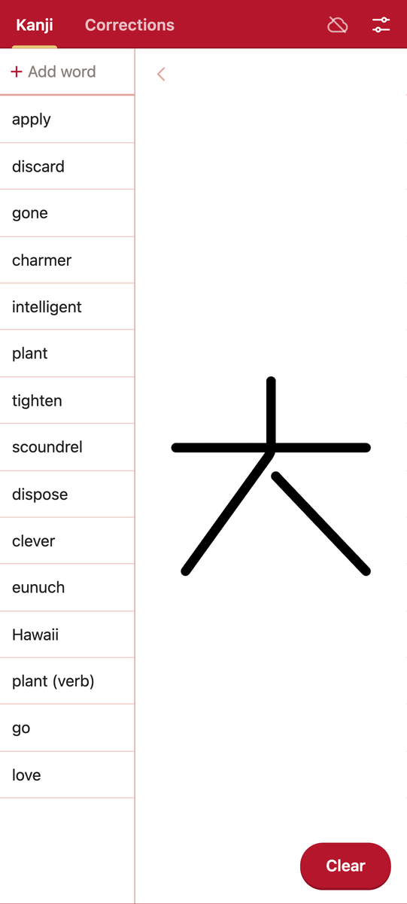
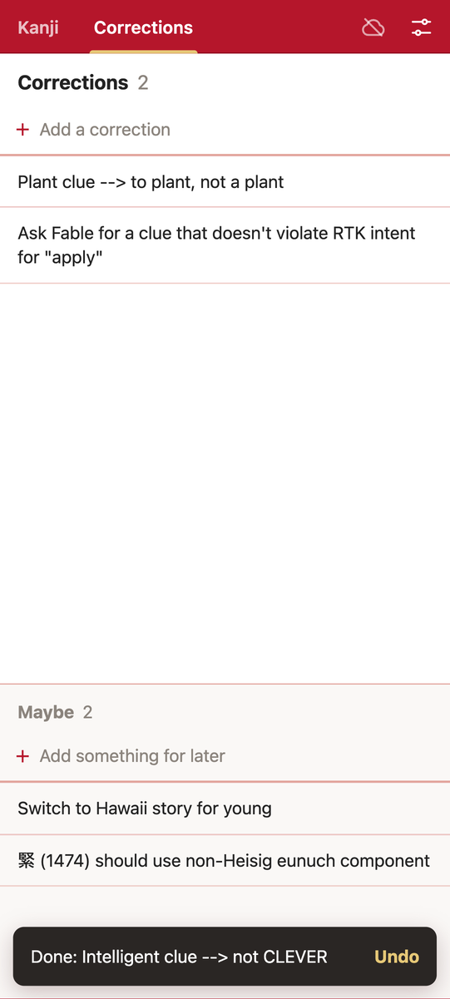
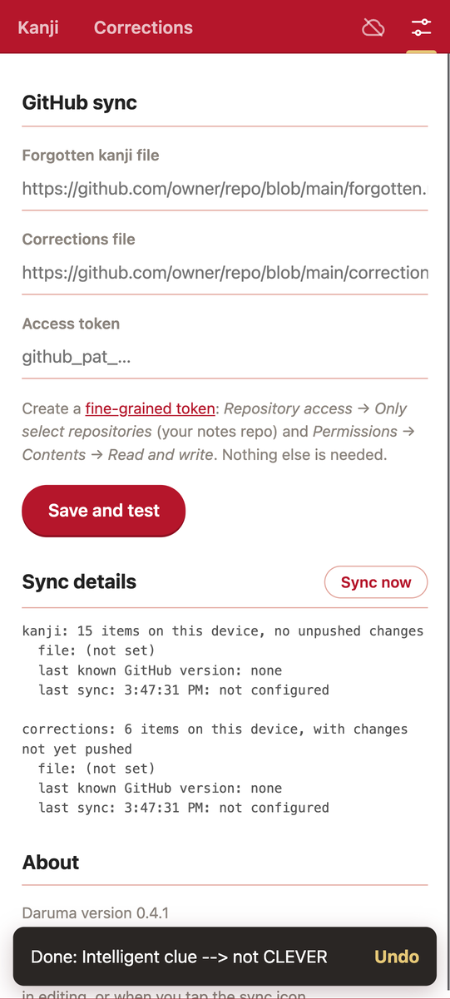

# Daruma


Daruma is a small installable web app (a PWA) for Japanese study chores. It runs entirely in the browser, keeps everything on the device first, and syncs its data to plain Markdown files in a GitHub repo of your choice.

The app lives at https://george-hawkins.github.io/japanese-study-app/

The icon is a daruma doll with only one eye painted in. Traditionally you paint in one eye when you set a goal and the other when you achieve it.

<p>
  
  
  
</p>

## Activities

The ? button in the top bar shows a summary of the gestures below.

**Kanji**: a list of English keywords for kanji you've forgotten, next to a scratch pad for writing kanji with your finger.

- Type a keyword in the box at the top and press Enter; new entries go at the top.
- Long-press an entry to edit or delete it.
- Draw on the pad and tap **Clear** to start again. There are deliberately no colours, widths or undo.
- ◀ / ▶ hides or shows the list to give more room for drawing.

**Corrections**: two lists of one-line notes, *Corrections* (to do soon) and *Maybe* (long-term reminders).

- Type in the box at the top of a list and press Enter to add an item at the top.
- Tap an item to edit it in place. Enter starts a new item below it, and an item left empty is removed.
- Swipe an item left or right to mark it done (with Undo). Done items are hidden in the app but kept in the file.
- Long-press an item to move it to the other list, mark it done or delete it.

## Setup

1. **Create a repo for the data**, e.g. `daruma-filestore`. It can be private, and it can be empty: the app creates the files.
2. **Create a fine-grained personal access token** at https://github.com/settings/personal-access-tokens/new:
   - *Repository access*: *Only select repositories* → the data repo.
   - *Permissions → Contents*: *Read and write*. Nothing else is needed.
3. **Open the app in Chrome on your phone** and choose ⋮ → **Add to home screen → Install**. On iOS, use Safari's Share → **Add to Home Screen**.
4. **In ⚙ Settings**, enter the file URLs, e.g. `https://github.com/george-hawkins/daruma-filestore/blob/master/forgotten.md` and `…/blob/master/corrections.md` (the branch must exist, or be the repo's default branch if the repo is still empty), and the token. Then tap **Save and test**.

The token is stored only on the device. A token is needed because GitHub doesn't support signing in from a purely static site (it requires a server-side secret).

## How data is saved

- Every change is saved on the device immediately, so nothing is lost if you switch away or the app is killed.
- Changes are pushed to GitHub, one commit per push, when you leave the app, a minute after your last edit, or when you tap the sync icon in the top bar. The app pulls from GitHub when it's opened or brought back to the front.
- Sync icon: a cloud with a tick (synced), with an arrow (changes waiting to be pushed; it pulses while syncing), crossed out (offline or not set up) or with "!" (needs attention; tap it).
- You can edit the files on GitHub too, e.g. to add a batch of entries. Open the app or tap the cloud before changing anything in the app, and it takes GitHub's version. If both have changed, the app asks whether to use GitHub's version, keep the device's version, or decide later.

The files look like this:

```markdown
# Forgotten kanji

* apply
* discard
```

```markdown
## Corrections

* Intelligent clue --> not CLEVER

## Maybe

* Switch to Hawaii story for young

## Done

* Discard clue: not DISPOSE
```

## Development

Plain HTML, CSS and JavaScript modules: no framework, no dependencies, no build step. To run it locally, serve the repo root with any static server and open it in a browser:

```
$ python3 -m http.server 8000
```

Then open http://localhost:8000/. Service workers work on `localhost` without HTTPS.

Layout:

| Path | Purpose |
| --- | --- |
| `index.html`, `styles.css` | The single page and its styles |
| `js/app.js` | Wiring: pages, tabs, sync indicator |
| `js/kanji.js`, `js/corrections.js` | The two activities |
| `js/sync.js` | Local-first documents and GitHub sync |
| `js/github.js` | Minimal GitHub Contents API client |
| `js/markdown.js` | Markdown ⇄ data conversion |
| `js/settings.js`, `js/store.js`, `js/ui.js` | Settings page, localStorage, shared UI helpers |
| `sw.js` | Network-first service worker (offline support) |
| `manifest.webmanifest`, `icons/` | PWA manifest and icons |
| `design/icon.svg`, `design/render-icons.sh` | Icon source and the script that renders the PNGs (macOS, needs Chrome) |

If you add a file the app needs, also add it to `SHELL` in `sw.js` so it's available offline.

### Deployment

GitHub Pages serves the repo root of the `master` branch (Settings → Pages → *Deploy from a branch*). Pushing to `master` redeploys the site. Installed copies pick up the new version the next time they're opened while online. Data stored on the device isn't affected by updates.

See [PLAN.md](PLAN.md) for the design decisions and the reasoning behind them.
